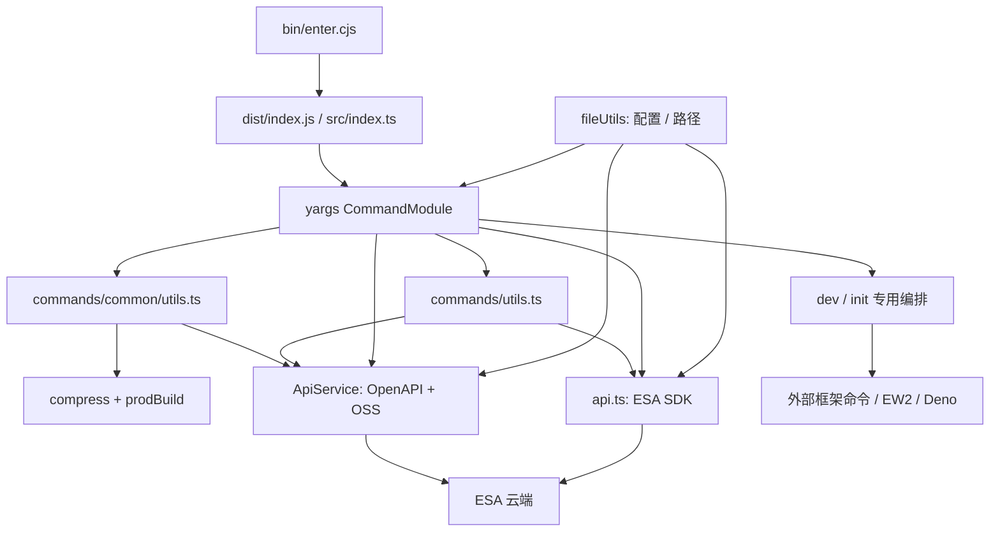

# ESA CLI 项目地图（AI 开发导航）

> 最近核对日期：2026-11-03；基线：将 master 合并到开发分支后的 `e8043a5` 加当前工作区 CI/发布改动；包版本：`esa-cli@1.0.13`。
> 本次复核版本、测试/CI/发布入口、CLI 更新通道、deploy 默认环境与版本绑定及文档导航。业务调用链来自 2026-09-21 的静态梳理，本次未逐条重新审计；相关实现变化时应回查当前源码。
> 用途：让 AI 按开发任务定位最小必要上下文，理解真实调用链，并选择验证方法。本文描述当前实现，不把重构提案视为已落地能力；源码变动后应重新核对相关章节。
> 路径均相对仓库根目录；定位使用“文件 + 符号”，避免依赖易漂移的行号。本文是导航，不替代用户要求或仓库开发约定。

## 1. 首次接手：先建立这几个事实

- **产品**：管理阿里云 ESA Functions & Pages 项目的 Node.js CLI，覆盖初始化、本地函数调试、打包上传、版本发布、项目/站点/域名/路由管理。
- **当前可发布实现**：`bin/enter.cjs` → 编译后的 `dist/index.js`；对应源代码为 `src/index.ts`。两个可执行命令 `esa`、`esa-cli` 指向同一个入口。
- **技术栈**：TypeScript strict + NodeNext/ESM、yargs、阿里云 SDK/OpenAPI、esbuild、AdmZip、Vitest；终端交互主要使用 `@clack/prompts`，部分路径仍用 inquirer，日志用 Winston/ora/chalk。
- **运行环境**：`package.json` 要求 Node.js ≥18；CI 构建矩阵为 Node 18/20/22/24 × macOS/Linux/Windows。能安装 CLI 不等于所有平台使用同一个本地边缘运行时。
- **命名对应**：用户命令是 `project`，代码目录是 `commands/routine`，云端 API 也使用 `Routine`。`deployments list/delete` 实际管理代码版本，不是通用部署任务系统。
- **工作目录区别**：CLI 仓库根、用户 ESA 项目根、用户 home 是三种不同目录。`getRoot()` 找用户项目配置；`getDirName(import.meta.url)` 找 CLI 自身资源；`os.homedir()` 找用户级配置与运行时。
- **实现边界**：`v2/` 被 `.gitignore` 与 `tsconfig.json` 排除；本地可能留有脚手架，但不属于当前构建、发布入口。没有已落地的统一 `ApiClient`、`CommandContext` 或 CAC 命令层。
- **文档位置**：原有用户文档在 `docs/`；本地图按要求放在 `doc/`。`copy.cjs` 只复制 `docs/`，本地图不随当前 npm 包发布。

### 阅读入口

开发流程见[开发与发布指南](./DEVELOPMENT_AND_RELEASE.md)，外部贡献流程见[贡献指南](../CONTRIBUTING.md)。

| 想回答的问题                         | 阅读位置                                                                     |
| ------------------------------------ | ---------------------------------------------------------------------------- |
| 我要改哪里、测什么？                 | [任务定位表](#2-按开发任务定位)                                              |
| 程序怎样启动、模块如何连接？         | [目录与依赖](#3-目录和依赖关系)、[命令表](#4-命令入口与公开接口)             |
| 一个功能从输入到输出经过什么？       | [核心流程](#5-核心流程)                                                      |
| 配置、凭据、路径从哪里来？           | [配置与状态](#6-配置优先级与运行时状态)                                      |
| 怎样调用 API、输出文案？             | [共享基础设施](#7-api终端交互与国际化)                                       |
| 怎样在本地和 CI 验证？               | [开发与测试](#8-开发构建测试与-ci)                                           |
| 有哪些不能从名称或旧文档推断的行为？ | [已知差异](#9-当前实现的易错边界)、[维护方法](#10-ai-执行任务与地图维护约定) |

## 2. 按开发任务定位

表中测试是优先检查的现有覆盖位置，不表示已经完整覆盖该能力。

| 开发任务                                | 首读文件 / 关键符号                                                                                                   | 连带检查                                                                        | 优先验证                                                                                                          |
| --------------------------------------- | --------------------------------------------------------------------------------------------------------------------- | ------------------------------------------------------------------------------- | ----------------------------------------------------------------------------------------------------------------- |
| 增加命令、参数或别名                    | `src/index.ts`；目标 `src/commands/**/index.ts` 的 `CommandModule`                                                    | 父命令注册、`.strict()`、`.fail()`、位置参数、退出码、中英文帮助                | `tests/compat/commands.test.ts` 的 `COMMAND_TREE` + 对应命令单测                                                  |
| 修复登录、STS、站点 endpoint            | `src/commands/login/index.ts`：`handleLogin`、`interactiveLogin`、`parseStsToken`；`src/utils/validateCredentials.ts` | `getApiConfig`、`checkIsLoginSuccess`、两套 API 的 `updateConfig`、`logout`     | `tests/commands/login.test.ts`、`logout.test.ts`、`tests/utils/fileUtils/index.test.ts`；交互回归用 E2E           |
| 修改项目根定位或配置合并                | `src/utils/fileUtils/base.ts`：`getRoot`；`index.ts`：`getProjectConfig`、`getApiConfig`、`getDevConf`                | 模块级缓存路径、JSONC/TOML 优先级、`projectPath` 和 cwd 差异                    | `tests/utils/fileUtils/` + `tests/compat/config.test.ts`                                                          |
| 增加框架、调整 init 产物                | `src/commands/init/template.jsonc`；`helper.ts`：`createProject`、`applyFileEdits`、`updateConfigFile`                | `types.ts`、`snippets/`、`copy.cjs`、外部 `esa-template` manifest               | `tests/commands/init.test.ts`、`tests/commands/init/helper.test.ts`；框架生成需另行实际验证                       |
| 改代码打包、静态资源 ZIP、`--no-bundle` | `src/utils/compress.ts`；`src/commands/commit/prodBuild.ts`                                                           | `checkEdgeRoutineType`、`NODE_EXTERNALS`、`.client.js` loader、Less、ZIP 内路径 | `tests/utils/checkAssetsExist.test.ts`、`tests/commands/commit/prodBuild.integration.test.ts`、commit/common 单测 |
| 改上传、生成版本、部署比例              | `src/commands/common/utils.ts`：`generateCodeVersion`、`commitAndDeployVersion`、`deployWithVersionPercentages`       | `ApiService`、OSS POST、版本状态轮询、默认部署环境、成功输出                    | `tests/commands/common/routineUtils.test.ts`、`commit.test.ts`、`deploy.test.ts`                                  |
| 改 dev 端口、热更新、进程退出           | `src/commands/dev/index.ts`、`doProcess.ts`；对应运行时 `devPack.ts`、`server.ts`                                     | `global.*`、`checkOS`、`checkDevPort`、watch 范围、运行时安装                   | `tests/commands/dev/doProcess.test.ts`；完整运行时链路需平台验证                                                  |
| 改 Cache / EdgeKV 本地模拟              | `src/commands/dev/build.ts`；`ew2/mock/`、`ew2/cacheService.ts`、`ew2/kvService.ts`、`mockWorker/mock/`               | Babel 标识符改写、HTTP 模拟接口、序列化、存储方式、`copy.cjs`                   | 新增针对实际行为的验证；现有测试目录没有完整运行时集成覆盖                                                        |
| 改路由语法或域名绑定                    | `src/commands/route/helper.ts`：两个 `transfer*`；`route/add.ts`；`domain/`                                           | `components/routeBuilder.ts`、站点匹配、API 字段大小写                          | `tests/commands/route/`、`tests/commands/domain/`、`tests/components/routeBuilder.test.ts`                        |
| 改项目/版本/站点列表或删除              | `src/commands/routine/`、`deployments/`、`site/`                                                                      | `commands/utils.ts`：`getRoutineCodeVersions`；分页和响应结构                   | `tests/commands/list.test.ts`、`delete.test.ts`、`deployments/`；站点无独立同名单测                               |
| 改终端样式、提示或语言                  | `src/libs/logger.ts`、`src/utils/prompt.ts`、`src/components/`、`src/i18n/index.ts`                                   | `genLocale.cjs`、`src/i18n/locales.json`、取消行为、ANSI、stdin/TTY             | `tests/components/`、dev 快捷键测试、相关命令测试；交互链路用 E2E                                                 |
| 改 npm 安装、依赖、发布内容             | `package.json`、`package-lock.json`、`bin/enter.cjs`、`copy.cjs`                                                      | NodeNext、pnpm `NODE_PATH`、运行时静态资源、lockfile registry                   | build + contract + `npm pack --dry-run`；参考 install-smoke CI                                                    |

## 3. 目录和依赖关系

```text
bin/enter.cjs                  CommonJS 启动器，spawn Node 执行实际入口
src/
  index.ts                     yargs 根注册、全局选项、版本检查 middleware
  commands/
    init/                      创建项目、框架配置、模板与 snippets
    dev/                       本地构建、监听与键盘操作
      ew2/                     EW2 子进程、Node HTTP 代理、Cache/KV 模拟
      mockWorker/              Deno 子进程与 Web API 模拟
    commit/                    保存代码版本入口、生产 esbuild 构建
    deploy/                    发布入口、版本展示辅助函数
    common/                    init/commit/deploy 共用发布编排、Node externals
    routine/                   project list/delete 的实现
    deployments/               代码版本列表和删除
    domain/ route/ site/       云端域名、路由、站点命令
    login/                     登录流程
    config.ts lang.ts logout.ts
    utils.ts                   登录校验、目录校验、域名绑定、版本查询
  libs/
    api.ts                     官方 ESA SDK 包装，导出 Client 实例
    apiService.ts              手写 OpenAPI RPC 与 OSS 上传，ApiService 单例
    interface.ts               API 请求/响应和领域类型
    service.ts                 较早的 ServiceOutput/上传发布封装
    logger.ts constants.ts     日志、包版本与 User-Agent
    git/ templates/            Git 辅助和 Template 模型
  utils/
    fileUtils/                 路径、配置读写、配置类型
    compress.ts                识别项目形态并生成 ZIP
    command.ts prompt.ts       子进程与交互封装
    installDeno.ts installEw2.ts install/ download.ts
    check*.ts                  平台/端口/版本/入口/资源/云端项目检查
  i18n/                        翻译读取器和双语词条
tests/                         单测、进程级 contract、E2E、真实 API 集成
docs/                          用户命令/配置文档、历史重构分析
doc/PROJECT_MAP.md             本地图
.github/                       CI 与依赖安装 composite action
genLocale.cjs copy.cjs         词条生成、运行时资源复制
```



这是主要调用方向，不是严格分层约束：命令可以直接访问 API；`fileUtils`、i18n、logger 存在相互导入；模块导入不保证没有 I/O 或单例初始化。

## 4. 命令入口与公开接口

权威注册点是 [src/index.ts](../src/index.ts) 和各 `CommandModule.builder`。帮助文案、参数名、短别名、必填参数、返回码共同构成 CLI 接口。

| 命令                      | 实现入口                                        | 关键行为                                                                    |
| ------------------------- | ----------------------------------------------- | --------------------------------------------------------------------------- |
| `init [name]`             | `src/commands/init/index.ts` → `handleInit`     | framework/template 两条创建路径；可安装依赖、初始化 Git、自动部署           |
| `dev [entry]`             | `src/commands/dev/index.ts` 的 handler          | 配置与端口检查、安装/检查运行时、打包、启动、watch                          |
| `commit [entry]`          | `src/commands/commit/index.ts` → `handleCommit` | 新建云端版本；描述可交互输入；不发布到环境                                  |
| `deploy [entry]`          | `src/commands/deploy/index.ts` → `handleDeploy` | 新建并发布、发布已有 `--version`、或按 `--versions` 分流                    |
| `deployments list/delete` | `src/commands/deployments/`                     | 当前项目版本查询；删除可用 `-i` 多选                                        |
| `project list/delete`     | `src/commands/routine/`                         | 账号项目列表与删除；delete 使用 `<projectName>`                             |
| `site list`               | `src/commands/site/list.ts`                     | 查询 active 站点，当前请求第 1 页、50 条                                    |
| `domain add/list/delete`  | `src/commands/domain/`                          | 当前项目的域名绑定；add/delete 使用 `<domain>`                              |
| `route add/list/delete`   | `src/commands/route/`                           | add 支持 `--route/-r`、`--site/-s`、`--alias/-a`；delete 使用 `<routeName>` |
| `login` / `logout`        | `src/commands/login/index.ts` / `logout.ts`     | AK/SK、STS、环境变量登录；清除保存的凭据                                    |
| `config`                  | `src/commands/config.ts`                        | `--local/-l` 或 `--global/-g` 用编辑器打开配置，不提供 set/get 子命令       |
| `lang`                    | `src/commands/lang.ts`                          | 交互选择 `en` / `zh_CN` 并保存                                              |

全局选项为 `--help/-h`、`--version/-v`、`--debug`、`--skip-update-check`。根级 `-v` 显示 CLI 版本，`deploy -v` 表示待发布代码版本；不能把二者合并为同一种语义。

## 5. 核心流程

### 5.1 启动与进程模型

1. `bin/enter.cjs` 优先找 `../dist/index.js`，再找 `../index.js`；找不到会抛错。
2. 使用 `cross-spawn` 启动当前 Node 可执行文件，透传参数与 stdio；为 pnpm 安装布局补充 `NODE_PATH`。
3. 启动器传递子进程退出码/信号，并在收到 SIGINT/SIGTERM 时停止子进程。
4. `src/index.ts` 读取 CLI 语言、注册命令并 `parse()`；middleware 开启 debug、执行可跳过的版本检查。
5. `checkCLIVersion()` 按安装版本选择 npm 镜像的 `latest` 或 `beta` 通道，5 秒超时，只在同通道出现更高 SemVer 时提示；不识别的预发布类型不查询更新。只有 `init` 可能进一步询问是否全局升级 CLI，升级命令保留对应通道。`init` 自身还会单独检查 `esa-template` 更新。

### 5.2 初始化项目

定位：[init/index.ts](../src/commands/init/index.ts)、[init/helper.ts](../src/commands/init/helper.ts)。

```text
handleInit
  → checkAndUpdatePackage('esa-template')
  → getInitParamsFromArgv
  → create: 配置名称/类型/模板/语言 → createProject → installDependencies
  → config: applyFileEdits → installESACli → updateConfigFile → initGit
  → deploy: 按选择 buildProject → deployProject → displayDeploySuccess
```

- **函数模板**：从安装的 `esa-template/src` 与 `manifest.json` 枚举；解析标题或目录，复制模板、改项目名，再由 `preInstallDependencies` 安装依赖并在有 build script 时执行构建。
- **框架模板**：`template.jsonc` 描述 scaffold 命令、语言参数、assets 目录、配置覆盖；目前包括 React、Vue、Next.js、Astro、React Router。Next.js 使用 static export，React Router 使用 SPA 配置。
- `snippets/` 是复制到用户项目的资源，不参与本仓库 TypeScript 编译；必须随 `copy.cjs` 进入发布产物。
- `--yes` 会设置 `git=true`、`deploy=true`、默认 Hello World 模板、`installEsaCli=false`；显式布尔参数可覆盖。它不是“只生成文件”的开关，也不能保证所有外部框架命令都无交互。
- 初始化包含 npm 查询/安装、外部脚手架、文件覆盖、可能的云端部署；不能用无约束 `init -y` 做纯帮助信息验证。

### 5.3 打包并保存版本

定位：[common/utils.ts](../src/commands/common/utils.ts)、[compress.ts](../src/utils/compress.ts)、[prodBuild.ts](../src/commands/commit/prodBuild.ts)。

```text
handleCommit
  → validateAndInitializeProject
      → 解析名称 → checkIsLoginSuccess → ensureRoutineExists
  → 获取版本描述
  → generateCodeVersion
      → compress → checkEdgeRoutineType → prodBuild（可跳过）
      → 打印源文件清单，组装 ConfOptions / ExtraInfo
      → commitRoutineWithAssets
          → CreateRoutineWithAssetsCodeVersion 获取 CodeVersion / OssPostConfig
          → uploadToOss 上传 ZIP（最多 3 次尝试）
  → 检查 CodeVersion，返回成功/失败
```

支持三种打包形态：仅函数、仅静态 assets、函数 + assets。ZIP 路径是接口契约：

```text
routine/index.js       动态入口（默认来自 esbuild 输出 .dev/pub.js）
assets/<相对路径>       递归收集 assets.directory 下文件，统一使用 /
```

`--no-bundle` 直接读取指定入口文本放入 `routine/index.js`，不会自动携带其所有相邻依赖。`prodBuild` 使用 ESM/browser 输出、Less 插件、`.client.js` text loader 和 `NODE_EXTERNALS`，构建后移除 `/*! ... */` 注释。

`notFoundStrategy` 在 `generateCodeVersion` 中转换为 API 的 `ConfOptions.NotFoundStrategy`；`singlePageApplication` 被标准化为 `SinglePageApplication`。`ExtraInfo` 标明 `{ Source: 'CLI' }`。

### 5.4 发布到环境

- 不带 `--version`：`commitAndDeployVersion` 先生成新版本，再发布；CLI 将所选环境传给 `generateCodeVersion`，新版本提交请求带对应的 `DeployEnv`。
- 带 `--version`：复用已有版本，跳过本地打包/上传，仍执行登录和云端项目检查；发布前核对已有版本的环境绑定。
- 单版本发布：`deployCodeVersion` → `waitForCodeVersionReady` → `validateCodeVersionTargets` → `createRoutineCodeDeployment`。轮询最多 5 分钟；状态 `init` 继续等待，`available` 可继续校验，其他状态返回失败。
- `deploy` 的 builder、普通发布 handler 和比例发布 handler 均默认 `production`；只有显式 `--environment staging` 才选择 staging。CLI 只接受这两个值，不接受 `--environment all`；common 内部 helper 保留的 `all` 分支不是 CLI 默认行为。
- `--versions v1:80,v2:20` 或重复传参走 `deployWithVersionPercentages` → `deployCodeVersions`；最多两个版本，总比例必须为 100，单版本必须为 100%。这条路径同样对每个版本调用 `waitForCodeVersionReady`，全部就绪并通过环境绑定校验后才发布。
- `validateCodeVersionTargets` 回读版本元数据：版本缺失、查询失败或 `DeployEnv` 与目标环境不一致会阻止发布；历史版本没有绑定时给出无环境变量快照的警告，再允许继续。
- `displayDeploySuccess` 获取默认域名并尝试追加 `esa_er_token`；获取 token 失败不阻断成功输出。

调用链中的“创建项目 / 保存版本 / 发布环境”是不同云端动作。`ensureRoutineExists` 可创建不存在的项目，且当前创建请求固定 `hasAssets: true`。

### 5.5 本地开发与运行时

定位：[dev/index.ts](../src/commands/dev/index.ts)、[dev/build.ts](../src/commands/dev/build.ts)。

| 路径 | 选择条件                                        | 执行模型                                                                                           | 本地模拟                                                                     |
| ---- | ----------------------------------------------- | -------------------------------------------------------------------------------------------------- | ---------------------------------------------------------------------------- |
| EW2  | `checkOS()` 返回 AppleArm、AppleIntel、LinuxX86 | `preCheckEw2` → `ew2/devPack` → `Ew2Server`；Node HTTP 服务代理到 EW2 子进程                       | `/mock_cache`、`/mock_kv` 转发到 Node 服务；KV 可从项目 `kv.json` 预载到内存 |
| Deno | 其余平台，包括 Windows                          | `preCheckDeno` → `mockWorker/devPack` → `MockWorkerServer`；Deno 执行包装入口、调用 `worker.fetch` | Cache 基于运行时 Cache API；KV 使用 `.dev/.kv` 文件                          |

共同流程：参数写入 `global.*` → 端口检查 → 生成带会话 id 的 `.dev/devEntry-*.js`、`.dev/index-*.js`、`devConfig.js` → 启动服务。EW2 另生成 `.dev/config-*.toml`；`dev/build.ts` 在 esbuild 结束后通过 Babel 改写 `cache` / `EdgeKV` 标识符。

chokidar 当前监听项目 `src/` 与 `.dev/` 的 `change` 事件，500ms 防抖；可先执行 `--refresh-command`。EW2 的 `restart(devPack)` 会重打包，Deno 的 `restart()` 当前只重启子进程。修改热更新时要逐条核对，不能假设两个实现等价。

快捷键在 `doProcess.ts`：`b` 打开浏览器，`c` 清屏，`x` / Ctrl+C 退出；Deno 额外显示 `d` 调试提示。默认 HTTP 端口 18080，Deno inspect 端口 9229，EW2 内部端口从 3322 起查找。

## 6. 配置优先级与运行时状态

权威实现：[fileUtils/index.ts](../src/utils/fileUtils/index.ts)、[base.ts](../src/utils/fileUtils/base.ts)、[interface.ts](../src/utils/fileUtils/interface.ts)。

### 6.1 文件与目录

| 对象                 | 路径 / 规则                                                          | 读写入口                                                                         |
| -------------------- | -------------------------------------------------------------------- | -------------------------------------------------------------------------------- |
| 项目配置             | 从 cwd 向父目录找最近的 `esa.jsonc` 或 `esa.toml`；同目录 JSONC 优先 | `getRoot`、`getProjectConfigPath`、`getProjectConfig`、`updateProjectConfigFile` |
| 无配置时的根目录     | `getRoot(root?)` 搜索到底后返回 `process.cwd()`                      | `getRoot`；不要推断一定返回传入的 `root`                                         |
| 全局配置             | `~/.esa/config/default.jsonc` 优先，否则 `default.toml`              | `getCliConfigPath`、`getCliConfig`、`updateCliConfigFile`                        |
| 全局配置初始化       | 创建目录与默认配置；默认 endpoint 为杭州                             | `generateDefaultConfig`，由 login 调用                                           |
| 用户项目构建中间文件 | `.dev/`；生产构建入口输出 `.dev/pub.js`                              | `prodBuild`、两个 `devPack`                                                      |
| CLI 日志             | `~/.esa-logs/esa-debug-%DATE%.log`                                   | `Logger`；测试环境禁用文件 transport                                             |
| 本地运行时           | `~/.ew2/`、`~/.deno/bin/`                                            | `installEw2.ts`、`installDeno.ts`、`download.ts`                                 |
| 框架配置资源         | CLI 包内 `commands/init/template.jsonc`、`snippets/`                 | init helper；不能混同用户 `esa.jsonc`                                            |

项目配置是可选的：`commit/deploy` 可从命令行入口或 assets 操作，名称解析为 `name 参数 > 项目配置 name > cwd 最后一段`。域名、路由、版本列表等命令仍要求项目配置。

### 6.2 优先级不是一条通用规则

| 使用场景                       | 当前实现                                                                                                |
| ------------------------------ | ------------------------------------------------------------------------------------------------------- |
| `getApiConfig()` 的 endpoint   | 项目配置 > 全局配置 > `esa.cn-hangzhou.aliyuncs.com`                                                    |
| `getApiConfig()` 的凭据        | 环境 AK/SK 均存在时采用环境凭据；否则浅合并默认、全局、项目配置后读取 `auth`                            |
| 环境变量同名来源               | 每个字段分别采用 `ALIBABA_CLOUD_*` > `ESA_*`                                                            |
| `handleLogin()`                | 完整环境 AK/SK > `--sts-token` > 显式 AK/SK 参数 > 已存凭据检查与交互登录                               |
| `checkIsLoginSuccess()`        | 每个凭据字段分别采用环境值或全局配置值，再验证并更新两套 API 客户端；与 `getApiConfig()` 的整组判断不同 |
| `getDevConf()`                 | `global[name]`（非 undefined）> 项目指定字段 > 调用点默认值；entry 读顶层，端口等读 `dev.*`             |
| commit/deploy 的 entry、assets | 命令行参数优先，然后使用项目配置；具体路径解析还取决于调用者是否传 `projectPath`                        |

支持的凭据环境字段：`ALIBABA_CLOUD_ACCESS_KEY_ID` / `ESA_ACCESS_KEY_ID`、`ALIBABA_CLOUD_ACCESS_KEY_SECRET` / `ESA_ACCESS_KEY_SECRET`、`ALIBABA_CLOUD_SECURITY_TOKEN` / `ESA_SECURITY_TOKEN`。代码直接读取 `process.env`，没有统一自动加载 `.env` 文件的入口。

`validateCredentials` 先使用 `CUSTOM_ENDPOINT`（若有），否则依次验证国内杭州、国际新加坡 endpoint。它是凭据验证路径的控制项，不是 `getApiConfig()` 的通用 endpoint 覆盖。保存式登录会记录探测成功的 endpoint；环境登录不持久化凭据。`checkIsLoginSuccess` 更新客户端时使用配置的 endpoint，不直接采用验证结果的 endpoint。

其他环境入口：`ESA_NO_UPDATE_CHECK` 跳过 CLI 更新检查；`ALIBABA_CLOUD_ESA_CLI_COMPAT_MODE` 修改根帮助中的命令名；`EDITOR` 选择配置编辑器。前者不跳过 init 的模板包更新逻辑。

### 6.3 状态与写回约束

- `fileUtils/index.ts` 的 `root`、`projectConfigPath`、`hiddenConfigDir` 等在模块导入时确定；后续 `chdir` 不会自动刷新这些常量。测试更换 cwd/home 时要在导入前安排环境，并按需 `vi.resetModules()` / `vi.doUnmock()`。
- 配置更新采用顶层浅合并；写入 `auth`、`assets`、`dev` 等对象时需带齐要保留的子字段。JSONC 写回经过 `JSON.stringify`，不会保留注释与原始排版。
- `readConfigFile` 不存在时返回 null，解析错误时会 `process.exit(1)`。配置类型带任意字段索引，不等于有完整的运行时 schema 校验。
- dev 依赖 `global.entry/port/inspectPort/minify/localUpstream/id/ew2Port` 等共享状态；handler 某些赋值有 truthy 判断，不能仅凭 `getConfigValue` 推断每个显式 false 都能覆盖配置。

## 7. API、终端交互与国际化

### 7.1 两套 API 客户端同时存在

| 模块                     | 结构与错误语义                                                                                                                                                      | 活跃调用举例                                                                      |
| ------------------------ | ------------------------------------------------------------------------------------------------------------------------------------------------------------------- | --------------------------------------------------------------------------------- |
| `src/libs/api.ts`        | 官方 `@alicloud/esa20240910`；模块导入时 `new Client()`；常见字段 `body.codeVersions`、`body.configs`；包装层记录后重新抛错，配置 10 秒连接/读取超时和最多 3 次尝试 | route list/delete、代码版本查询                                                   |
| `src/libs/apiService.ts` | `ApiService.getInstance()` 惰性单例；手写 `callApi` RPC，常见字段 `data.CodeVersion`，部分方法例外（如 `body.Routines`）；多数方法捕获错误并返回 null/false         | 项目/站点/域名、route add、生成版本、OSS 上传、发布、访问 token                   |
| `src/libs/service.ts`    | `ServiceOutput { success, message, data }` 与早期上传/提交/发布封装                                                                                                 | 当前 `src` 命令主链没有导入它；不能把其中 `quickDeployRoutine` 当成 deploy 主实现 |

修改 API 时先查调用点与返回字段，不可跨客户端直接复用大小写约定或错误判断。`src/libs/interface.ts` 维护手写类型；SDK 请求类型来自依赖。两个客户端都支持 STS 并使用 `CLI_USER_AGENT`，修改认证不能只改其中一套。

### 7.2 交互、日志与文案

- `src/utils/prompt.ts` 统一包装 text/select/multiselect/confirm/multiLevelSelect，取消通常以 130 退出；login、routeBuilder 等直接使用 clack 的路径可能返回而不退出。
- `selectInput.ts` 保留回调接口；`mutiLevelSelect.ts` 返回叶子路径；`mutiSelectTable.ts` 返回标签数组。`muti` 是真实文件名，检索时不要改写成 `multi`。
- route add 的部分输入、端口冲突提示和升级确认仍使用 inquirer；不能认为 UI 已完全统一。
- `logger.log/success/error` 等有终端输出，`logger.info` 主要写日志；`--debug` 控制 debug 输出。存在直接 `console.log/error`，当前没有全局统一 JSON 输出模式。
- ESLint 明确禁止在 CLI 源码重新引入 `react`、`ink`、`ink-text-input`、`ink-select-input`。初始化 React 应用的模板不受“CLI 不使用 React”这一架构事实影响。
- 文案写法为 `t('key', variables).d('English default')`。实际词条在 `src/i18n/locales.json`；根目录 `locale/zh.json` 不是当前 `t()` 的数据源。
- `genLocale.cjs` 从 `src/` 扫描上述写法，更新英文并为新 key 留空中文。新增文案应运行生成脚本并补齐 `zh_CN`；`t()` 对完全缺失的 key 会访问 `locales[key].en`，不能只依赖 `.d()` 保证兜底。

## 8. 开发、构建、测试与 CI

### 8.1 本地开发命令

从 CLI 仓库根运行，使用已有依赖或先 `npm ci`：

```bash
npm run lint
npx tsc --noEmit
npx vitest run
npm run build
npm run test:compat:v1
```

这些命令应按改动范围选择，而不是每次无条件全跑。自动化单次执行用 `vitest run`；`npm test` 是 `vitest --coverage`，本地可能进入 watch，带覆盖率的单次执行用 `npm run test:ci`。

`npm run dev` 只运行 `tsc --watch`，既不启动 ESA dev 服务，也不执行词条生成或静态资源复制。运行真实 CLI 前先完整 build；修改 snippet、安装脚本、mock JS 后只有 tsc 不够。

### 8.2 构建与发布内容

```text
npm run build
  → rimraf ./dist ./build
  → node genLocale.cjs       会写回受 Git 跟踪的 src/i18n/locales.json
  → tsc                     src → dist，NodeNext，TS 相对 import 使用 .js 后缀
  → node copy.cjs           补齐运行时非 TS 资源
```

`copy.cjs` 复制 bin、docs、两个 devEntry/mock 目录、cliconfig、install 脚本、locales、init template 与 snippets。`package.json.files` 发布 bin、dist、README 和中文说明；`prepublishOnly` 负责发布前构建。`npm pack` 本身不能替代显式 build。

构建可能更新 locales，完成后检查 `git diff`；不要把生成词条的变化误认成无关用户修改，也不要直接编辑 `dist/` 作为修复。

### 8.3 测试层次

| 层次                 | 配置 / 目录                                                 | 单次执行                                          | 前置条件与边界                                                                                   |
| -------------------- | ----------------------------------------------------------- | ------------------------------------------------- | ------------------------------------------------------------------------------------------------ |
| 默认单测与本地库集成 | `vitest.config.js`；`tests/commands`、`utils`、`components` | `npx vitest run` 或 `npm test -- --run`           | 使用 `tests/setupTest.ts` 广泛 mock API/配置；不覆盖真实云端行为                                 |
| CLI contract         | `vitest.compat.config.ts`；`tests/compat`                   | `npm run test:compat:v1`                          | 先 build；spawn CLI 检查命令、选项、help、退出和配置解析；无真实账号要求                         |
| 交互 E2E             | `vitest.e2e.v1.config.ts`；`tests/e2e/v1`                   | `npx vitest run --config vitest.e2e.v1.config.ts` | 先 build；使用本地 API fixture，成功/拒绝登录与登出无需云凭据                                    |
| 真实 API 集成        | `vitest.integration.config.ts`；`tests/integration`         | `npm run test:integration:v1`                     | 先 build 或通过 ESA_CLI_BIN 指定安装后的包；完整配置专用账号、站点、测试子域和写入开关；顺序运行 |

默认配置按目录排除 compat/e2e/integration，**不是按文件名排除**。`tests/commands/commit/prodBuild.integration.test.ts` 和 `tests/utils/download.integration.test.ts` 仍由默认套件运行，分别验证真实 esbuild + Less 和本地 ZIP 解压，不需要 ESA 凭据。

覆盖率 provider 为 Istanbul，当前最低阈值：statements 31%、branches 27%、functions 23%、lines 31%。这只是 CI 门槛，不能推出某条业务链已经被充分验证。

测试编写与排查重点：

- `tests/setupTest.ts` 同时 mock `api.ts` 与 `ApiService`，并 mock 多个配置/目录/登录入口；要验证真实实现时，显式解除相关 mock，参考两个本地 integration 用例。
- `tests/compat/commands.test.ts` 的 `COMMAND_TREE` 是维护中的接口清单，新增参数要同步；它不能取代源代码注册，也不保证目前包含每个新选项。
- contract/E2E 在没有 `dist/index.js` 时直接失败。`ESA_CLI_BIN` 可指定 contract/API 集成的测试入口；v1 E2E 固定使用 `bin/enter.cjs`。
- 子进程测试隔离 home：helper 同时设置子进程 `HOME` / `USERPROFILE`，避免 Windows 与 Unix 路径差异；`tests/support/cli-process.ts` 清除继承的云凭据和 Node preload，设置更新检查开关与进程级超时；contract/E2E 通过测试 preload 阻止真实 HTTP(S) 外联。
- 交互测试发送最后一次输入后关闭 stdin；超时直接失败，成功和取消场景均检查正常退出。配置契约测试通过 `tests/fixtures/read-config.mjs` 在独立进程读取编译后的配置模块，断言字段值、端口和优先级；另用本地 API fixture 验证实际 CLI 请求中的项目名。
- clack 的 Enter 输入使用 `\r`；输出断言先去 ANSI，参考 `tests/e2e/helper.ts`。管道 stdin 与真实 TTY 的退出行为可能不同。
- API 集成完整配置由 `scripts/release/integration-config.mjs` 校验，包括 AK/SK、站点 ID/名称、专用子域后缀和 `ESA_TEST_ALLOW_WRITE=1`；可选 endpoint/STS token。`ESA_TEST_REQUIRE_INTEGRATION=1` 时缺配置即失败，本地未启用强制模式时可跳过。
- 真实 API 用例验证资源回读和删除；`deploy.test.ts` 用唯一项目完成上传、staging 部署和 HTTP 响应核对。`cloud-resources.json` 记录清理失败/中断时的临时资源。未配置真实账号前，不能声称这些用例已在云端通过。
- `tests/release-tools/*.test.mjs` 使用 Node test runner，由 `npm run test:release-tools` 执行，覆盖门禁、配置、发布冲突和重试行为；不属于默认 Vitest 套件。

### 8.4 CI 与代码约定

- `.github/workflows/main.yml`：十二组 OS/Node 18/20/22/24 组合运行安装、lint、测试、build、pack；另有 npm 本地/全局/exec、Yarn Classic、pnpm 本地/全局、Bun 安装 smoke。
- `.github/workflows/main.yml` 调用 reusable `compat.yml`，最终 `CI Gate` 必须依赖所有必需 job 成功；监听 push、PR、merge_group，也可供 Release 调用。
- `.github/workflows/compat.yml`：仅通过 workflow_call 调用；build 后执行离线 contract/E2E，校验报告无跳过，由 `Behaviour Gate` 汇总。
- `.github/workflows/release.yml`：唯一的手动发布入口，选择 `release/<完整版本>`、准确 SHA 与 `beta`/`stable`/`hotfix` 类型。beta/stable 候选必须已在 master 历史中；hotfix 从 npm 当前 latest 正式版的可证明 tag 派生，允许独立于 master，发布后通过 PR 合回 master。三类都重跑完整 CI → 安装最终 tarball → `esa-integration` 审批与真实 staging/API 测试 → `npm-release` 审批 → OIDC 发布同一包、tag 和 GitHub Release。需按[开发与发布指南](DEVELOPMENT_AND_RELEASE.md)操作，并按[配置手册](GITHUB_SETUP_AND_RELEASE.md)完成远端验收。
- `scripts/release/`：支持 beta 和 beta → stable 的版本准备；校验候选、报告、产物及已发布来源。stable 相对当前 beta 仅允许版本、`CHANGELOG.md` 和本次新版本说明变更；hotfix 仅允许当前 latest 的下一 patch 且必填原因。manifest 绑定通道、发布类型与来源身份；发布重试会拒绝遗留草稿、不同包或 tag 冲突。此目录不随 npm 包发布。
- `.github/actions/setup-and-install/action.yml`：行为测试工作流使用它校验 lockfile 的 resolved 地址均来自 `registry.npmjs.org`，并要求 npm ci 与 npm ls 都成功、失败重试；不能把 lifecycle 失败当成成功。
- `.eslintrc.cjs`：单引号、导入分组与排序、未使用变量检查、禁止 React/Ink；`any` 为 warning。`.prettierrc`：单引号、无尾逗号、箭头函数保留括号。
- Husky pre-commit 调用 lint-staged；`.lintstagedrc.cjs` 与 package.json 都有相关定义。实际执行不能只从某一个配置块猜测，也不能用 staged 检查代替整仓库 CI。

## 9. 当前实现的易错边界

以下是源码阅读得到的现状与定位线索，不表示本次进行了运行时缺陷复现。

| 边界                                   | 源码证据与开发含义                                                                                                                                                                        |
| -------------------------------------- | ----------------------------------------------------------------------------------------------------------------------------------------------------------------------------------------- |
| 历史提案不是当前架构                   | `docs/refactoring-proposal.md` 提到 CAC、统一 Ink、单一 API、上下文对象；当前 package、入口与 ESLint 均不能支持这些已落地的结论。`.qoder/` 是被忽略的生成资料，也不是实现依据。           |
| `config --global` 与配置读取选择不同   | `config.ts` 打开固定 `cliConfigPath`（default.toml），读取器却优先 default.jsonc；改配置编辑功能时要同时检查两者。                                                                        |
| deploy 默认 production，并校验版本绑定 | builder、两条 handler 路径及 `commitAndDeployVersion` 参数默认均为 `production`；目标环境必须匹配已有 `DeployEnv`，无绑定历史版本只警告。内部 helper 的 `all` 不是 CLI 可选值或默认行为。 |
| dev 与生产打包覆盖范围不同             | compress 支持 assets-only；两个 devPack 仍生成函数入口包装，缺省指向 `src/index.js`，未实现与云端 Pages 等价的完整静态资源托管路径。                                                      |
| dev 两个后端行为不完全一致             | restart、upstream 读取、Cache/KV 数据实现各自独立；Deno 的 restart 不调用传入的重打包函数，监听也不覆盖所有自定义入口目录。                                                               |
| 项目根定位不等于全部路径已统一         | fileUtils 的默认 root 来自导入时缓存；compress 中部分 `path.resolve(projectPath ?? '', ...)` 在未传 projectPath 时依赖 cwd。排查“子目录运行”必须跟完整传参链。                            |
| 失败输出不总等于非零退出               | `handleCommit/handleDeploy` 有显式成功/失败码；部分登录和资源命令打印失败后 return，`ensureRoutineExists` 创建失败调用无参数 `exit()`。日志、返回值和退出码需分别验证。                   |
| JSONC 支持有具体实现限制               | 配置解析器用状态机去注释，再以正则去尾逗号；不要视为完整 JSONC parser。init 的 `template.jsonc` 更是直接 `JSON.parse`，不能因为扩展名而任意加入注释。                                     |
| API 响应类型不统一                     | `api.ts` 常用小写 SDK 字段，`ApiService` 多为 PascalCase；`listUserRoutines` 又使用 body。测试 mock 也不能保证与真实接口完全一致。                                                        |
| 普通 deploy 不替用户构建前端           | 它打包入口和现有 assets，不执行项目配置的 `buildCommand/installCommand`；框架构建发生在 init 特定流程或用户自行运行的 build 中。                                                          |
| 更新开关作用域有限                     | `--skip-update-check` / `ESA_NO_UPDATE_CHECK` 控制 CLI 版本检查；init 模板更新和 dev 运行时检查是各自的网络路径。                                                                         |

## 10. AI 执行任务与地图维护约定

### 最小上下文工作顺序

1. 先读用户要求和当前 `git status --short`，确认这次修改属于命令接口、业务编排、配置、运行时还是发布工具链。
2. 用第 2 节找到入口，沿真实 import 与函数调用读到副作用边界；区分当前 handler、历史 helper、生成资源、计划中的设计。
3. 明确行为契约：输入参数、配置优先级、产物格式、API 字段、交互取消、失败返回/退出码。
4. 小范围修改并复用现有能力。跨 init/commit/deploy 的行为优先检查 common；跨两套 API、两个 dev 后端的行为要逐条确认是否需要同步。
5. 选择针对性单测；涉及 CLI 参数、help、启动/退出时 build 后跑 contract；涉及真实运行时或云端时单独安排相应验证，并记录实际完成与未验证范围。
6. 检查 locales、用户文档、命令清单、copy 清单是否需更新；完成后核对 diff，避免把 dist、运行时缓存或本地资料作为源码提交。

### 常用检索

```bash
# 正常检索尊重 .gitignore，不扫描 node_modules/dist/v2/.qoder
rg --files src tests docs doc bin .github
rg -n 'command:|\.option\(|\.positional\(|\.command\(' src/index.ts src/commands
rg -n '目标符号' src tests
rg -n 'getProjectConfig|getApiConfig|getRoot|global\.' src
rg -n 'ApiService|getInstance|api\.' src/commands src/utils
rg -n 'spawn|execSync|process\.exit|exit\(' bin src
```

### 地图更新触发条件

- 新增/移除命令或参数：更新第 2、4 节，核对 contract 命令清单与中英文用户文档。
- 改入口、构建、依赖或运行时资源：更新第 1、3、5、8 节。
- 改配置、凭据、路径、全局状态：更新第 6 节及受影响的流程。
- 改 API、UI 框架、测试分层：更新第 7、8 节，并移除第 9 节中已修复的差异。
- 刷新文首日期与源码基线；只写能由当前实现核对的事实，将建议和未验证假设单独标明。

### 继续阅读

- [GitHub 配置与发布手册](GITHUB_SETUP_AND_RELEASE.md)：管理员逐项步骤、配置效果、日常开发和正式发布操作。
- [开源开发、测试门禁与发布评估](OPEN_SOURCE_RELEASE_RESEARCH.md)：2026-09-20 的历史调研、当时的 workflow 缺口与本地结果；用于了解方案背景，当前操作以开发与发布指南为准。
- [README](../README.md)：产品与开发入口。
- [中文命令参考](../docs/Commands_zh_CN.md) / [英文命令参考](../docs/Commands_en.md)：用户操作说明；选项细节以当前 builder 为准。
- [中文配置参考](../docs/Config_zh_CN.md) / [英文配置参考](../docs/Config_en.md)：项目配置用途。
- [yargs 限制分析](../docs/yargs-limitations.md)：理解历史命令组织问题，涉及现状时回查源码。
- [历史重构提案](../docs/refactoring-proposal.md)：背景材料，不是当前实施规范。
